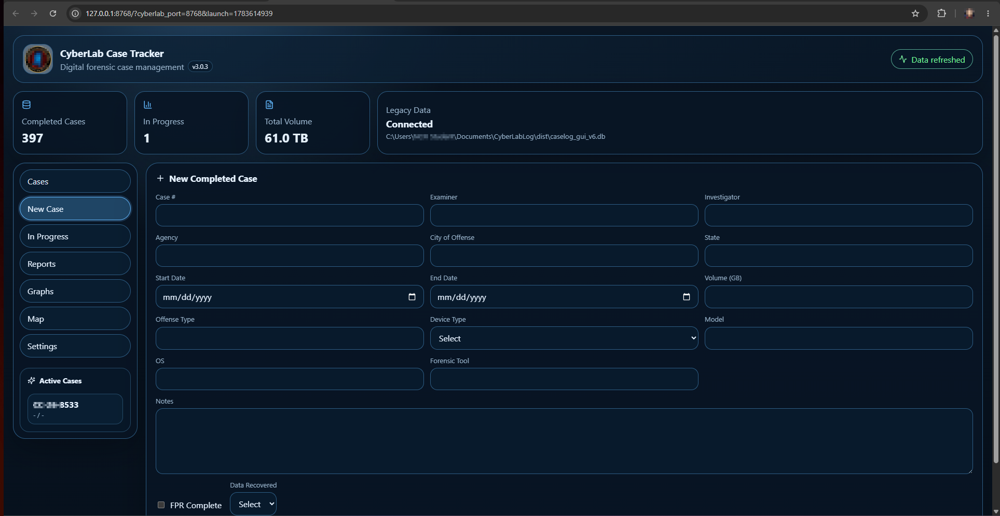

# CyberLab Case Tracker

A local case management, reporting, mapping, and analytics application for digital forensics labs and agencies. Track cases and evidence, maintain custody records, and produce reports through a browser interface backed by a local Python service.

The modern application remains compatible with the legacy `caselog_gui_v6.db` database and `app_data` folder.

**[Download for Windows](https://github.com/RF-YVY/CyberLabLog/releases)** · **[Full feature list](#full-feature-list)** · **[Development guide](modern_app/README.md)**



## Contents

- [Getting started](#getting-started)
- [Full feature list](#full-feature-list)
- [Screenshots](#screenshots)
- [Updating and migrating](#updating-and-migrating)
- [Data storage and privacy](#data-storage-and-privacy)
- [Excel import reference](#excel-import-reference)
- [Running from source](#running-from-source)
- [Support](#support)
- [License and credits](#license-and-credits)

## Getting started

### Windows release

Download a package from [GitHub Releases](https://github.com/RF-YVY/CyberLabLog/releases). Choose either:

| Package | Setup |
| --- | --- |
| Portable EXE | Place the EXE in a writable folder and launch it. Create a desktop shortcut if desired. |
| Per-user installer | Run the installer to place the application in a writable user folder. Administrator privileges are not required. |

The packaged application includes its runtime; a separate Python or Node.js installation is not required. The database and `app_data` folder are stored beside the application EXE. The installer retains these files when uninstalling.

### First use

1. Launch CyberLab Case Tracker. The application opens in your browser.
2. Use **Settings** to configure agency branding, preferences, and any legacy data imports.
3. Open **New Case**, enter shared case information and device details, and choose **Completed** or **In-Progress**.
4. Select **Save & Finish**, or **Save & Add Next Evidence Item** to continue the same case with the next evidence suffix.
5. Use **Cases**, **Map**, **Graphs**, and **Reports** to review records and generate outputs.

## Full feature list

| Area | Capabilities |
| --- | --- |
| Case management | Shared case workspaces, completed and in-progress records, search, filters, and consecutive evidence intake |
| Evidence and custody | Evidence inventories, custody timelines, case history, and case-family reports |
| Evidence labels | Saved exhibit labels, QR codes, agency branding, Windows printing, and PDF/PNG output |
| Mapping | Location lookup, precise coordinates, location repair, and standalone offline map reports |
| Analytics and reporting | Workload summaries, turnaround metrics, charts, and multiple export formats |
| Automation | Scheduled reports with catch-up handling after sleep or missed polling times |
| Personalization | Themes, backgrounds, branding, configurable fields, tabs, and tables |
| Data and deployment | Local storage, encrypted portable backups, legacy migration, portable deployment, and in-app updates |

### Case management and intake

- **Unified case workspaces:** Group completed and in-progress evidence under a base case number, with actions to view, edit, and prepare the next evidence item.
- **Detailed case records:** Capture examiner, investigator, investigation subject, agency, location, offense, device type, model, operating system, forensic tools, processed volume, recovery results, FPR status, and notes.
- **Flexible submission:** Save new records directly to **Completed** or **In-Progress**, and complete active cases after saving final edits.
- **Consecutive evidence entry:** Use **Save & Add Next Evidence Item** to retain shared information, clear device details and results, and suggest the next available evidence suffix across both case lists.
- **Search and organization:** Browse, search, filter, sort, view, edit, duplicate, and delete case records. Agency and offense sorting supports case-insensitive alphabetical ordering.
- **Active workload views:** Focus on due, overdue, awaiting-evidence, ready-to-close, and assigned work.
- **Draft recovery:** Recover autosaved intake drafts, review saved-item summaries, and receive warnings before leaving unfinished entries.
- **Entry assistance:** Use reusable templates, inline field validation, alphabetized dropdowns, and visible save confirmations.
- **Data review:** Open affected records, normalize inconsistent values, and merge duplicate records through review actions.

### Evidence inventory and chain of custody

- **Evidence inventories:** Maintain evidence details within each case.
- **Custody timelines:** Record chain-of-custody events alongside the related evidence.
- **Case history:** Review recorded changes and activity.
- **Case families:** Link numbered device sub-cases and combine their evidence, custody history, volume totals, and individual results in a family PDF.

### Evidence labels and printing

- **Label generation:** Create labels from **New Case** or completed and in-progress case details.
- **Saved exhibit details:** Retain per-exhibit label fields, serial numbers, locations, extra named fields, and editable QR values.
- **Automatic exhibit numbering:** Infer the exhibit number from the numeric evidence suffix, or use **1** for an unsuffixed case.
- **Agency branding:** Configure agency and division titles with a separate label logo.
- **Label dimensions:** Use the default Dymo 550 shipping-label size of **4 × 2 5/16 inches**, or specify custom dimensions.
- **Direct Windows printing:** Select a default or per-job label printer. Labels are rotated for Dymo feed orientation and fitted within the printer's hardware margins.
- **PDF previews:** Open exact-size PDFs through a local address, with open/download fallbacks.
- **Image downloads:** Download individual label PNGs at 300 pixels per inch.
- **Case-wide output:** Print every label in a case family or download a ZIP containing one PNG per exhibit.
- **Layout checks:** Detect text overflow before output so fields can be shortened or removed.

Configure defaults in **Settings → Evidence Label Settings**. When printing a PDF, match the paper size and use **Actual size / 100%** scaling. Check alignment on the target printer.

### Mapping and location management

- **Flexible locations:** Map city/state entries, named landmarks, offshore sites, and exact latitude/longitude coordinates.
- **Automatic lookup:** Geocode new and edited locations and cache successful results for reuse.
- **Location repair:** Use **Refresh Missing Locations** to recheck completed and in-progress records, retry invalid coordinates, and report unresolved locations. A database backup precedes repairs; valid precise coordinates are preserved.
- **Interactive maps:** Choose a map focus and use custom transparent map markers.
- **Offline map reports:** Export standalone HTML maps with embedded map assets and a county basemap that works without an API key.
- **Geographic context:** Display county boundaries, county names, selected city names, and case markers with labels that avoid overlaps.
- **Optional imagery:** Fetch and embed a USGS detail layer during report generation for later viewing.
- **Saved report viewer:** Open exported case snapshots through **Reports → Open Map Report**.
- **Map data exports:** Export geographic data as JSON for additional analysis.

### Analytics, reports, and exports

- **Category analysis:** Review offenses, agencies, device types, examiners, investigators, cities, states, forensic tools, and volume totals.
- **Workload reports:** Summarize devices, device types, and processed volume for a date range and selected examiner, investigator, or agency.
- **Turnaround metrics:** Include average turnaround time in date-scoped and all-time PDF summaries.
- **Case-family reports:** Produce combined PDFs containing device summaries, evidence inventories, custody history, results, and total volume.
- **Document and data formats:** Export PDF, XLSX, CSV, and JSON outputs.
- **Graph exports:** Create PNG overviews, graph CSV files, and paginated vector PDFs with readable labels and a shared axis scale.
- **Complete category coverage:** Enable **Graph PNG overview + full PDF** to pair a compact overview with a PDF containing every category; CSV exports retain all values.
- **Map exports:** Generate standalone HTML reports and map JSON files.
- **Readable PDF layouts:** Wrap long content and paginate detail tables and chart categories.

### Scheduled reporting

- **Automated exports:** Generate report, graph, and map outputs while the application is open.
- **Schedule controls:** Save the weekly day, time, and enabled state explicitly.
- **Catch-up handling:** Resume scheduled work after Windows sleep, wake, or missed polling times, with duplicate-run protection.
- **On-demand startup:** Open the application without automatically generating report files during startup.

### Appearance and workspace customization

- **Theme selection:** Choose light, dark, glass, high-contrast, and other theme styles, including **Lab Light** and **Lab Dark**.
- **Custom backgrounds:** Load a PNG, JPG, or WebP image up to 20 MB and show or hide it without deleting the saved image.
- **Animation preferences:** Control interface animations, with reduced-motion support for animated themes.
- **Agency identity:** Customize the application header title, report logo, and map marker.
- **Tabs and fields:** Rename or hide tabs and fields, add custom informational tabs, and create user-defined case fields.
- **Table preferences:** Retain selected columns and comfortable or compact row spacing per browser.
- **Browser choice:** Select the system default browser, Chrome, Edge, or automatic detection.

### Backups, migration, and deployment

- **Local storage:** Keep case records in the local SQLite database and preferences and assets in `app_data`.
- **Database backups:** Create backups from **Settings** and before supported data replacement or repair operations.
- **Encrypted portable backups:** Protect database and application assets with a password, including integrity verification during restore.
- **Legacy migration:** Reuse the existing `caselog_gui_v6.db` and `app_data` beside the EXE, or import a legacy database and zipped application assets from **Settings**.
- **Support bundles:** Generate diagnostic bundles from **Settings**.
- **Portable Windows application:** Run the packaged EXE from a writable folder without a separate Python or Node.js installation.
- **Per-user installer:** Install without administrator privileges and retain local case data when uninstalling.
- **In-app updates:** Check for releases, verify downloads, back up the database, replace the executable, and restart while retaining cases, settings, and images.
- **Update recovery:** Retain the previous executable and an installation log; download the EXE separately for manual deployment when needed.

## Screenshots

Additional application screenshots:


## Updating and migrating

### In-app updates

In a packaged Windows release, open **Settings → Portable Application Update**, select **Check**, then **Download & Install**.

The updater verifies the download against GitHub's SHA-256 digest and asset size, backs up the database, replaces the EXE, and restarts the application. It retains the previous executable as `.exe.previous` and writes results to `app_data/update-install.log`. Cases, settings, and uploaded images remain in place.

**Download EXE only** is available for manual deployment. If your installed version does not offer **Download & Install**, update manually to a release that supports it. Source checkouts support download-only updates.

### Manual updates and legacy data

1. Close the application and back up the application folder.
2. Replace the old EXE with the new release EXE.
3. Keep `caselog_gui_v6.db` and `app_data` beside the EXE to retain cases, settings, logos, and map markers.
4. Launch the application and confirm the expected case totals.

You can also import legacy data from **Settings**. Database import and restore workflows create backups before replacing active data.

## Data storage and privacy

| Location | Contents |
| --- | --- |
| `caselog_gui_v6.db` | Local SQLite case database |
| `app_data/` | Settings, uploaded images, cached assets, and application data |
| `app_data/backups/` | Database and portable backups |
| `app_data/automated_reports/` | Scheduled report outputs |

The live SQLite database is not encrypted by the application. Password-protected portable backups use encryption; they are separate from the active database.

Case records remain local. Automatic location lookup sends location text, such as a landmark, city, or state, to OpenStreetMap's Nominatim geocoding service. Enter exact coordinates when a lookup is unnecessary. Online map layers, optional imagery, and update checks also require external requests.

When contributing, keep case data, databases, logs, credentials, and generated reports out of version control. Review the repository's [.gitignore](.gitignore) before adding files.

## Excel import reference

The legacy desktop application includes an XLSX case importer. Use an exported workbook as a starting point so column labels match the application configuration. This reference describes the legacy workflow; the modern application's migration options are documented above.


| Column header | Description | Recommended format |
| --- | --- | --- |
| `ID` | Record identifier | Generated during import; not mapped from the workbook |
| `Case #` | Case number | Text |
| `Examiner` | Examiner name | Text |
| `Investigator` | Investigator name | Text |
| `Agency` | Agency or organization | Text |
| `City` | Case location city | Text |
| `State` | Case location state | Text |
| `Start (MM-DD-YYYY)` | Case start date | MM-DD-YYYY |
| `End (MM-DD-YYYY)` | Case end date | MM-DD-YYYY |
| `Vol (GB)` | Processed volume in gigabytes | Number |
| `Offense` | Offense type | Text |
| `Device` | Device type | Text |
| `Model` | Device model | Text |
| `OS` | Operating system | Text |
| `Forensic Tool` | Tool used for examination | Text |
| `Recovered?` | Data recovery status | Yes / No |
| `FPR?` | FPR completion status | Yes / No |
| `Notes` | Case notes | Text |
| `Created (YYYY-MM-DD)` | Record creation date | Generated during import; not mapped from the workbook |

The importer matches configured display labels or internal field names without regard to capitalization and trims surrounding header whitespace. It maps recognized columns rather than requiring every column listed above. Use **Yes** or **No** for boolean fields and consistent date formats for predictable results.

## Running from source

### Modern application

The current interface uses a FastAPI backend and a React/Vite frontend. Source development requires Python and Node.js/npm compatible with the dependencies in the project manifests. See the [modern application guide](modern_app/README.md) for architecture, development servers, and Windows packaging.

From the repository root, install dependencies and build the interface:

```powershell
python -m pip install -r modern_app/backend/requirements.txt
cd modern_app/frontend
npm install
npm run build
cd ../..
python modern_app/launch_modern_app.py
```

The application opens at `http://127.0.0.1:8768`. In development, it uses the repository-root database and `app_data` folder.

### Legacy desktop application

The original Tkinter interface remains in `CyberLabCaseTracker.py`. Its dependencies are listed in [requirements.txt](requirements.txt); the modern backend has a separate dependency file. See the source imports for any additional legacy dependencies needed for a particular workflow.

```powershell
python CyberLabCaseTracker.py
```

## Support

For deployment assistance, contact your system administrator or application provider.

- **Developer:** [RF-YVY](https://github.com/RF-YVY)
- **Downloads and release notes:** [GitHub Releases](https://github.com/RF-YVY/CyberLabLog/releases)
- **Development documentation:** [Modern application guide](modern_app/README.md)
- **Earlier changes:** [Changelog](CHANGELOG.md)

## License and credits

Released under the [MIT License](LICENSE).

[Forensics icons created by Iconjam — Flaticon](https://www.flaticon.com/free-icons/forensics).
